# System workflow in diagrams

One order travels from a sales channel to a carrier through PostgreSQL, an outbox, RabbitMQ,
a DynamoDB read model and a Valkey cache. This page draws that journey from the outside in:
what runs where, who does what, how an order changes state, and what happens in time when
things go right and wrong. Every diagram is checked against the code; the file that proves it
is named under it.

The diagrams are [Mermaid](https://mermaid.js.org/), so GitHub renders them in place.

## Quick path

1. Read **1. System architecture** to see the boxes and where the data lives.
2. Read **3. Use cases** and **4. Order lifecycle** to learn the business vocabulary.
3. Pick a sequence diagram (section 5) for the question you are studying.
4. Read **6. Known gaps** before an interview: it lists what the lab deliberately does not do.

| If you want to understand... | Look at |
| --- | --- |
| What runs on my machine and how it talks | [1. System architecture](#1-system-architecture) |
| Where domain, application and adapters sit | [2. Code architecture](#2-code-architecture) |
| Who can do what | [3. Use cases](#3-use-cases) |
| Valid order and shipment states | [4. Order lifecycle](#4-order-lifecycle) |
| Two workers, one unit of stock | [5.2 Allocation race](#52-allocation-race-the-last-unit) |
| How a change becomes an event and a read model | [5.3 Commit to projection](#53-from-commit-to-read-model) |
| A carrier that times out after shipping | [5.4 Unknown carrier outcome](#54-shipping-when-the-carrier-response-is-lost) |
| Duplicate and lost webhooks | [5.5 Webhook](#55-webhook-ingest-and-duplicates) and [5.6 Reconciliation](#56-reconciliation-polling-repairs-lost-inbound-channel-events) |
| Retries and the dead-letter queue | [5.7 Consumer retries](#57-consumer-retries-and-the-dead-letter-queue) |
| The cache | [5.8 Cache-aside read](#58-cache-aside-read) |

---

## 1. System architecture

**PostgreSQL is the source of truth.** Everything else is derived from it, or protects it.

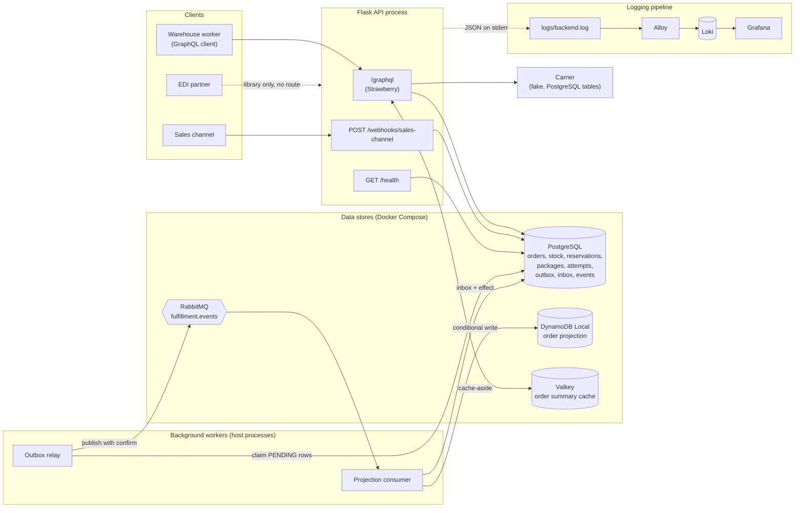

Proof: `compose.yaml`, `src/api/service_composition.py`, `scripts/demo/run_demo.py`.

Reading the picture:

- **Writes** go to PostgreSQL in one transaction, together with a row in the **outbox**.
- **The relay** moves outbox rows to RabbitMQ. **The projection consumer** turns them into a
  DynamoDB read model. This is the "events" half of *events plus reconciliation*.
- **Valkey** only caches the order summary header, for 30 seconds. If it is down, reads
  fall through to PostgreSQL.
- **The carrier** is called *outside* any WMS transaction, because it is an external system.

| Service | Host port | Used by |
| --- | --- | --- |
| PostgreSQL | 55432 | Everything transactional |
| RabbitMQ | 55672 (AMQP), 55673 (UI) | Relay publisher, projection consumer |
| Valkey | 56379 | Order summary cache |
| DynamoDB Local | 58000 | Order projection |
| Loki / Alloy / Grafana | 53100 / 52345 / 53000 | Logs |

## 2. Code architecture

The repository is organised by business capability (screaming architecture). Inside each
capability the dependency arrows point inward.

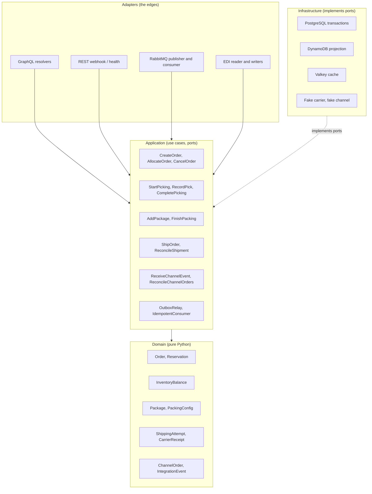

| Capability | What it owns | Layers |
| --- | --- | --- |
| `inventory` | Stock balances per client, SKU, warehouse, location | domain, application, infrastructure |
| `orders` | The Order aggregate, allocation, cancel, read side (cache, projection) | domain, application, infrastructure |
| `picking` | Start, record, complete picking | application (reuses `orders`) |
| `packing` | Packages and the packing conservation check | domain, application, infrastructure |
| `shipping` | Shipping attempt, carrier port, recovery | domain, application, infrastructure |
| `messaging` | Outbox, inbox, relay, RabbitMQ | domain, application, infrastructure |
| `integrations` | Webhook and reconciliation, EDI edge adapter | domain, application, infrastructure, `edi/` |
| `api` | Flask host, GraphQL, REST, the composition root | adapters only |
| `observability` | JSON logging, request-scoped log context | flat |

**One honest exception.** `PostgresOrderTransaction` imports the packing, shipping and
inventory schemas, because order, stock, reservations, packages, attempts and outbox must
commit atomically in one transaction. The trade-off is written down in
[`decisions/order-transaction.md`](decisions/order-transaction.md).

## 3. Use cases

Who triggers what. Solid arrows have a runtime entry point; dashed ones exist as tested code
and drills, but nothing in the running API calls them.

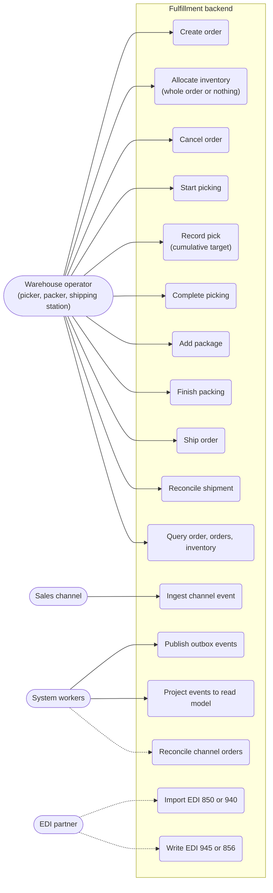

| Use case | Entry point | Event recorded |
| --- | --- | --- |
| Create order | GraphQL `createOrder`; also webhook and EDI intake | none |
| Allocate inventory | GraphQL `allocateInventory` (runs `AllocateOrder`) | `OrderAllocated` |
| Cancel order | GraphQL `cancelOrder` | `OrderCancelled` |
| Start picking / record pick | GraphQL `startPicking`, `recordPick` | none |
| Complete picking | GraphQL `completePicking` | `PickingCompleted` |
| Add package / finish packing | GraphQL `addPackage`, `finishPacking` | `OrderPacked` (on finish) |
| Ship order / reconcile shipment | GraphQL `shipOrder`, `reconcileShipment` | `OrderShipped` |
| Ingest channel event | `POST /webhooks/sales-channel` | none |
| Publish outbox events | `OutboxRelay` (demo worker script) | n/a |
| Project events | `python -m orders.infrastructure.order_projection_cli run` | n/a |
| Reconcile channel orders | drills and tests only | none |
| EDI import and advice | drills and tests only | none |

Every GraphQL request needs the `X-Client-Id` header. It scopes all data to that owner and
is only a stand-in for authentication.

## 4. Order lifecycle

Business operations move the order, not a generic `updateStatus`. Repeating an operation that
already happened is a harmless no-op, so a retry after a lost response is safe.

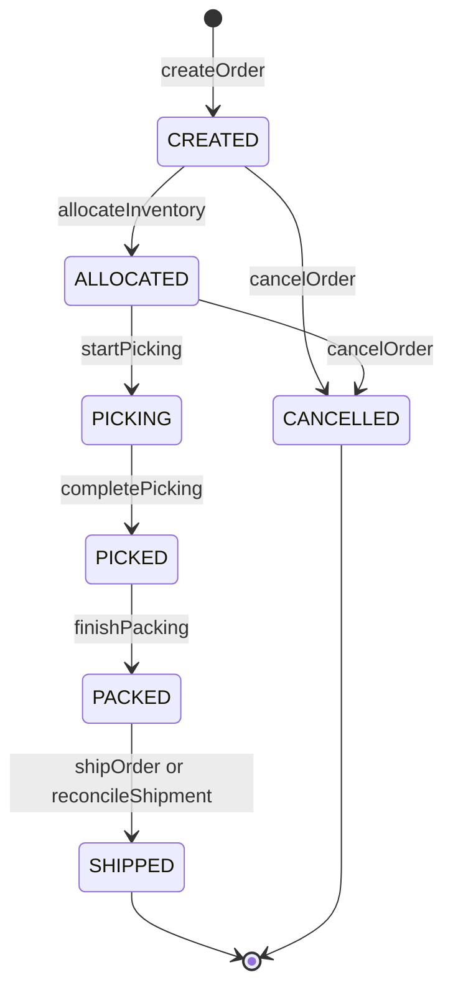

Proof: `src/orders/domain/order_status.py`, `order.py`.

- Cancellation is allowed only **before picking**. A cancel from `ALLOCATED` releases the
  reservations; the reservation rows stay as history.
- `SHIPPED` and `CANCELLED` are terminal.

### Shipment attempt

An order has exactly **one** shipping attempt, with an ID derived from its owner and order
number. That stable ID is what makes carrier retries safe.

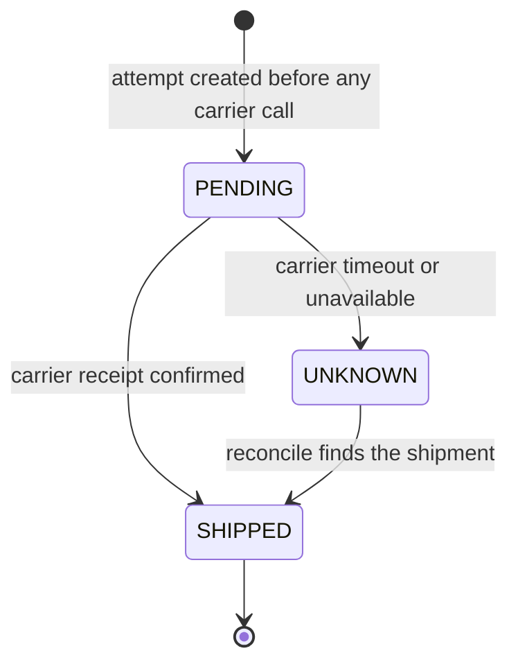

### Stock buckets

Stock rows hold `on_hand`, `allocated`, `picked` (and a `packed` column that no flow writes).
`available = on_hand - allocated`.

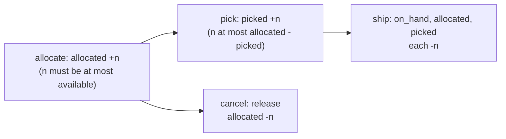

Invariants: `allocated <= on_hand` and `picked <= allocated`.

---

## 5. Sequence diagrams

### 5.1 One order through the warehouse (happy path)

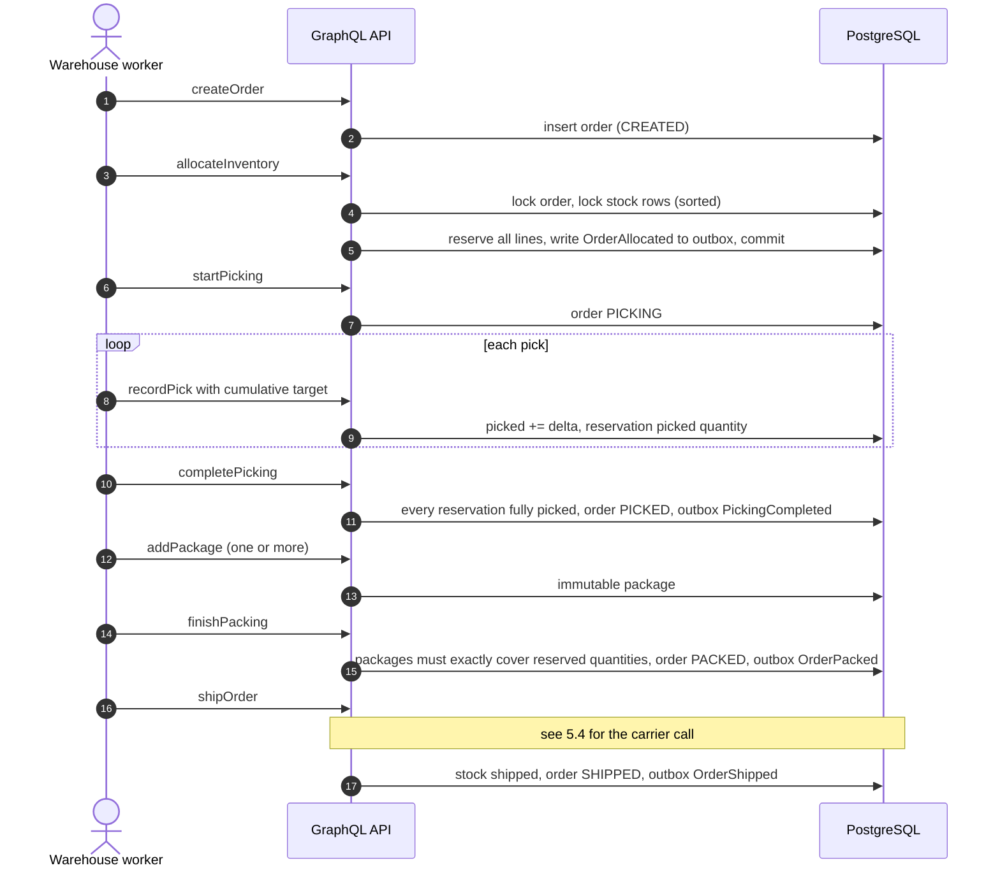

### 5.2 Allocation race: the last unit

Two orders want the last unit of the same SKU. Each use case runs in a fresh READ COMMITTED
transaction that locks the order first and the stock rows second, always in sorted order.
That ordering is what avoids deadlocks.

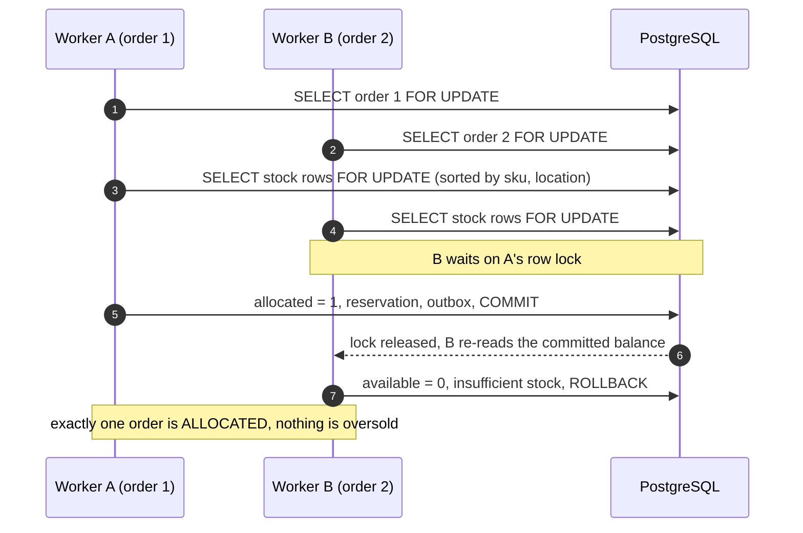

Proof: `src/orders/infrastructure/postgres_order_transaction.py`, drill 1 in
[`failure-drills.md`](failure-drills.md).

### 5.3 From commit to read model

The event is part of the business transaction, so it cannot be lost or invented. Delivery
afterwards is **at-least-once**. Repeats are harmless because of **two separate guards**: the
PostgreSQL inbox suppresses a delivery once its row has committed, and the DynamoDB writes
are idempotent on their own, which covers the window before that commit.

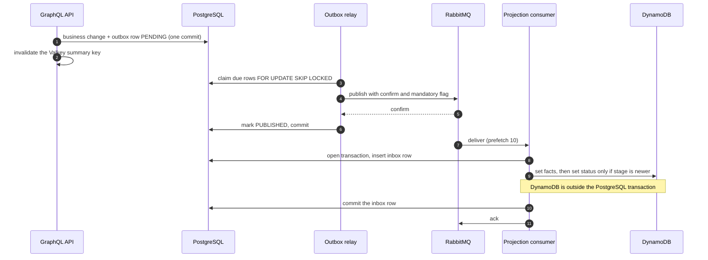

- A crash between publish and "mark PUBLISHED" re-publishes the row: a duplicate, never a loss.
- A crash between the inbox commit and the ack redelivers the message: the inbox insert
  conflicts, so the projector does not run again.
- **A crash between the DynamoDB write and the inbox commit** is the gap the inbox cannot
  close. The projection has already changed, but the inbox row rolls back, so the redelivery
  runs the projector a second time. That is safe only because the projection's own writes are
  idempotent: the facts are unconditional sets of the same values, and the status write is
  guarded by `attribute_not_exists(stage) OR stage < :stage`. The inbox makes the *local*
  effect atomic with the dedupe record; it cannot do that for a remote store.
- Out-of-order events cannot move the read model backwards: the stage condition rejects them.

### 5.4 Shipping when the carrier response is lost

The carrier is an external system. We never call it inside a WMS transaction, and we always
ask before we create.

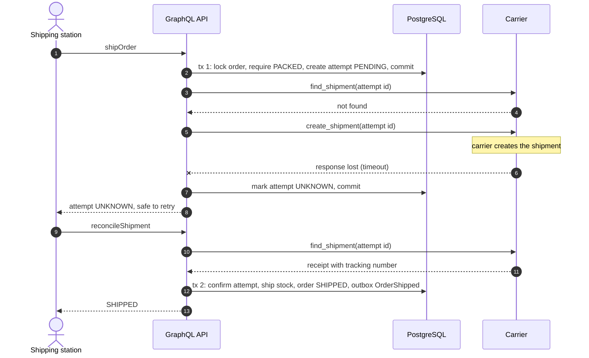

Because the attempt ID is deterministic and `create_shipment` is idempotent per attempt, the
carrier creates the shipment once however many times we retry. Proof:
`src/shipping/application/ship_order.py`, `reconcile_shipment.py`; drill 2.

### 5.5 Webhook ingest and duplicates

The raw event is stored *first*, so a failure leaves evidence. The inbox then makes
processing idempotent.

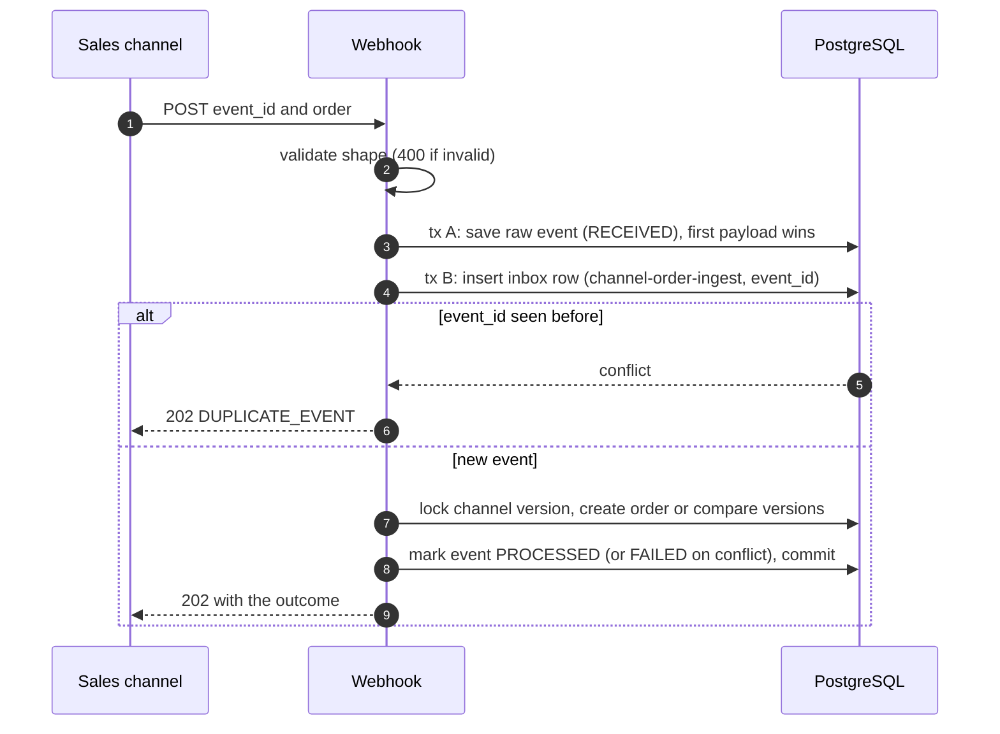

Outcomes: `CREATED`, `ALREADY_KNOWN`, `STALE_IGNORED`, `CONFLICT`, `DUPLICATE_EVENT`. A `202`
means "received and handled by policy", not "business success": always read `outcome`. The
full contract is [`api/sales-channel-webhook.md`](api/sales-channel-webhook.md).

### 5.6 Reconciliation polling repairs lost inbound channel events

A webhook can be lost, so the system also polls the sales channel. This repairs *incoming*
orders only: it does not replay the fulfillment outbox and does not touch RabbitMQ or
DynamoDB (for a stale projection, see 5.7). The checkpoint never moves backwards, and
each run re-reads an **overlap window** so late orders are not missed.

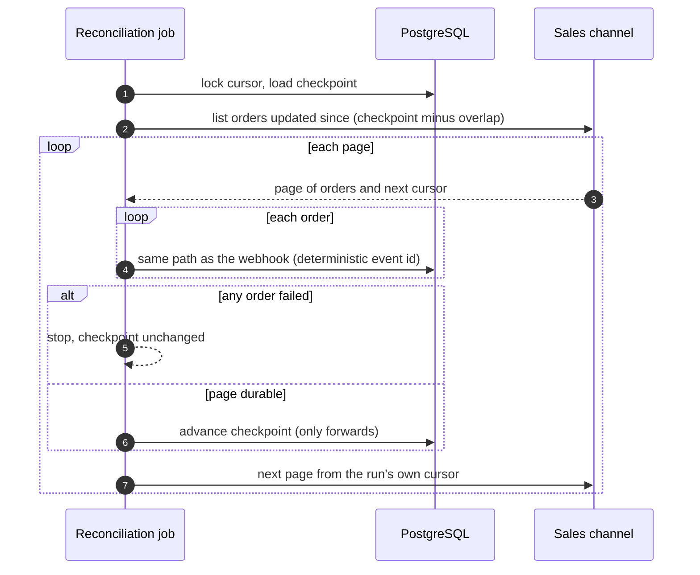

### 5.7 Consumer retries and the dead-letter queue

A failing handler must not crash the worker. The consumer republishes explicitly so it can
count attempts.

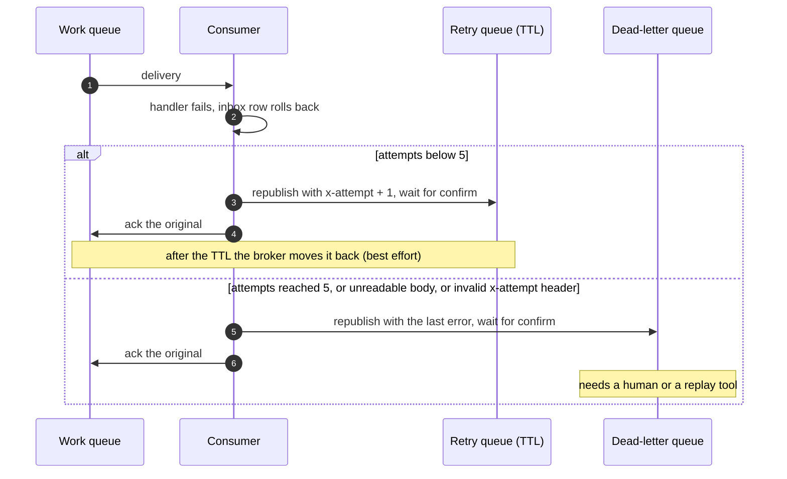

The hop out of the retry queue is done by the broker and is **not confirmed**. If the work
queue is missing at that moment the message can be dropped, and the outbox row is already
`PUBLISHED`, so the relay will not resend it.

**Recovery for the projection** is `order_projection_cli rebuild`: it wipes the derived
DynamoDB table and replays every retained `order` outbox row, whatever its delivery status
([rebuild procedure](study/order-projection.md#rebuild)). Channel reconciliation (5.6) is *not*
a recovery for this: it polls the sales channel, and an order it already knows simply returns
`ALREADY_KNOWN` while its lost `OrderPacked` or `OrderShipped` event stays missing.

Not implemented: a generic replay tool for the retry queue or the DLQ, and a replay of only
the affected window. See [`study/messaging.md`](study/messaging.md).

### 5.8 Cache-aside read

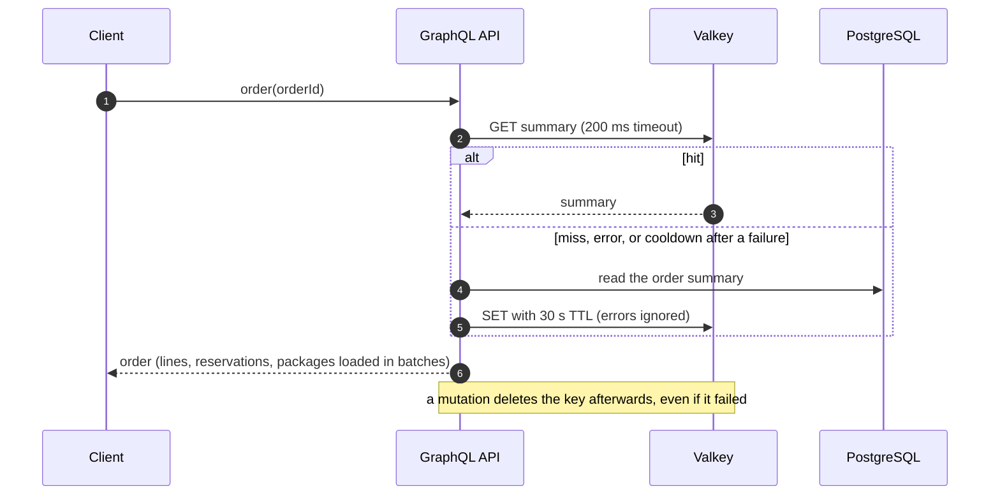

Allocation never reads the cache: it locks and reads PostgreSQL directly.

---

## 6. Known gaps

These are deliberate lab boundaries, not bugs. Say them out loud in an interview before
someone asks.

| Gap | What exists instead |
| --- | --- |
| The DynamoDB projection has no reader in the API | `order` and `orders` read PostgreSQL (through Valkey). The projection is read by tests, the demo and drills. |
| No production loop for the outbox relay | `scripts/demo/outbox_relay_worker.py` wires the same classes the tests use. |
| `ReconcileChannelOrders` and EDI have no runtime entry point | Run by drills and tests only. |
| `PICKING` and `CREATED` never reach the projection | `CreateOrder`, `StartPicking` and `RecordPick` publish no events. |
| `InventoryBalance.pack()` is not implemented | The `packed` column exists; packing is checked against reservations, not stock. |
| No stock-receiving use case | The demo seeds stock with SQL. |
| `X-Client-Id` is not authentication | A real deployment verifies a credential at the edge. |
| The webhook is unsigned | Verify the sender's signature before parsing. |
| Retry-queue TTL hop is best effort | Run `order_projection_cli rebuild` for the projection. There is no affected-window replay. |
| No replay tool for the DLQ or the retry queue | Parked messages need a human, or a projection rebuild. |
| The inbox cannot make DynamoDB writes atomic with PostgreSQL | The projection's idempotent, conditional writes absorb the repeat (see 5.3). |

## 7. Where to read next

| Topic | Document |
| --- | --- |
| Run everything end to end with predictions | [`demo.md`](demo.md) |
| Break it on purpose (8 drills) | [`failure-drills.md`](failure-drills.md) |
| Vocabulary and rules | [`domain-glossary.md`](domain-glossary.md), [`domain-rules.md`](domain-rules.md) |
| Allocation and locking | [`study/order-allocation.md`](study/order-allocation.md), [`study/transactional-allocation.md`](study/transactional-allocation.md) |
| Picking and packing | [`study/picking.md`](study/picking.md), [`study/packing.md`](study/packing.md) |
| Shipping and unknown outcomes | [`study/shipping.md`](study/shipping.md) |
| Outbox, inbox, RabbitMQ | [`study/messaging.md`](study/messaging.md) |
| Read model and cache | [`study/order-projection.md`](study/order-projection.md), [`study/read-cache.md`](study/read-cache.md) |
| Webhook, polling, EDI | [`study/reconciliation.md`](study/reconciliation.md), [`study/edi.md`](study/edi.md), [`api/sales-channel-webhook.md`](api/sales-channel-webhook.md) |
| GraphQL adapter | [`study/graphql-api.md`](study/graphql-api.md), [`api/schema.graphql`](api/schema.graphql) |
| Logs | [`study/observability.md`](study/observability.md) |
| Mapping to AWS | [`aws-map.md`](aws-map.md) |
